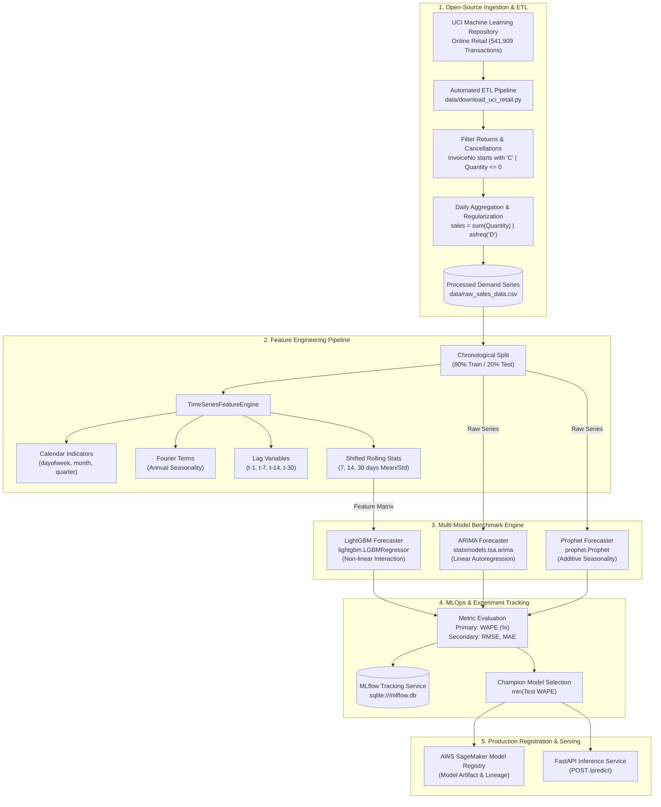

# Enterprise Multi-Model Demand Forecasting Engine

[](https://www.python.org/)
[](https://mlflow.org/)
[](https://fastapi.tiangolo.com/)
[](https://aws.amazon.com/sagemaker/)

Production-grade multi-model time-series forecasting and MLOps pipeline. The system trains statistical (**ARIMA**), additive (**Prophet**), and gradient-boosted (**LightGBM**) models in parallel on real-world retail transactions, logs experiments with **MLflow**, benchmarks candidate runs via **WAPE** (Weighted Absolute Percentage Error), and registers champion models on **AWS SageMaker Model Registry**.

---

## 🏛️ System Architecture



---

## 📊 Dataset Specification & Extraction Pipeline

### Source Dataset
The pipeline uses the **[UCI Machine Learning Repository: Online Retail Dataset](https://archive.ics.uci.edu/dataset/352/online+retail)** (Dataset ID: 352).

- **Data Origin:** Real transactional records from a UK-based registered non-store online retail enterprise selling unique all-occasion giftware (wholesalers & individual consumers).
- **Time Horizon:** 01/12/2010 to 09/12/2011.
- **Raw Volume:** 541,909 individual purchase transaction rows.
- **Automated Extractor:** [`data/download_uci_retail.py`](file:///C:/BetaProj/Project/demand_forcast/data/download_uci_retail.py)

---

### How the Data is Extracted and Formatted

Rather than using synthetic series, [`data/download_uci_retail.py`](file:///C:/BetaProj/Project/demand_forcast/data/download_uci_retail.py) automatically downloads and extracts the raw transactions directly from the UCI repository:

```
UCI Zip Archive (online+retail.zip)
       │
       ▼
Extract 'Online Retail.xlsx' (541k+ transactions)
       │
       ▼
Filter Cancellations (`InvoiceNo` starts with 'C' or `Quantity` <= 0)
       │
       ▼
Aggregate to Daily Granularity (`sales = sum(Quantity)`)
       │
       ▼
Fill Calendar Gaps (`asfreq('D')` to establish continuous time series)
       │
       ▼
Export to `data/raw_sales_data.csv`
```

#### Final Demand Schema (`data/raw_sales_data.csv`):
| Column | Type | Description | Example |
| :--- | :--- | :--- | :--- |
| `date` | `string` (`YYYY-MM-DD`) | Continuous daily calendar date | `2010-12-01` |
| `sales` | `float` | Total aggregated units demanded | `26814.00` |

#### Leakage-Free Design:
- **Strict Chronological Split:** The first 80% of dates are used for model training; the subsequent 20% are held out for out-of-sample benchmarking. No random shuffling.
- **Shifted Feature Generation:** Lags and rolling window statistics (7, 14, 30 days) are computed strictly with a `shift(1)` offset to eliminate lookahead bias.

---

## 🛠️ Project Structure

```text
├── data/
│   ├── download_uci_retail.py    # Downloads & processes real-world UCI dataset
│   └── raw_sales_data.csv        # Extracted daily demand time-series
├── src/
│   ├── __init__.py
│   ├── config.py                 # Centralized Pydantic settings & env config
│   ├── api.py                    # FastAPI serving endpoint (/predict, /health)
│   ├── features/
│   │   ├── __init__.py
│   │   └── build_features.py     # Calendar, Fourier, Lag, Rolling stats
│   ├── models/
│   │   ├── __init__.py
│   │   ├── metrics.py            # WAPE, RMSE, MAE metrics calculator
│   │   ├── train_arima.py        # ARIMA forecaster with MLflow logging
│   │   ├── train_prophet.py      # Prophet forecaster with MLflow logging
│   │   └── train_lightgbm.py     # LightGBM forecaster with MLflow logging
│   └── tracking/
│       ├── __init__.py
│       └── mlflow_registry.py    # AWS SageMaker Model Registry integration
├── tests/
│   ├── test_features.py          # Feature engineering unit tests
│   └── test_models.py            # Model training & metrics tests
├── main.py                       # End-to-end benchmark orchestrator
├── pytest.ini                    # Pytest configuration
├── requirements.txt              # Pinned Python package dependencies
├── .env.example                  # Environment configuration template
├── .gitignore                    # Git ignore rules for MLOps
└── README.md
```

---

## 🚀 Getting Started

### 1. Environment Setup
```powershell
uv venv --python 3.12
.venv\Scripts\activate
uv pip install -r requirements.txt
```

### 2. Download Real-Life Dataset (Optional / Auto-fetched)
To download and prepare the UCI Online Retail dataset:
```powershell
.venv\Scripts\python.exe data\download_uci_retail.py
```
*(If `data/raw_sales_data.csv` is absent when running `main.py`, it will automatically download and process it for you).*

### 3. Run the Multi-Model Forecasting Pipeline
```powershell
.venv\Scripts\python.exe main.py
```
This executes:
1. Ingestion of real-world demand from `data/raw_sales_data.csv`.
2. Chronological 80/20 train/test split.
3. Feature engineering (calendar, Fourier harmonics, lags $t-1, t-7, t-14, t-30$, rolling windows $7, 14, 30$).
4. Parallel training of **ARIMA**, **Prophet**, and **LightGBM**.
5. Automated experiment logging in MLflow (`sqlite:///mlflow.db`).
6. Model selection leaderboard ranking by **WAPE (%)**.
7. AWS SageMaker Model Registry registration hook for the champion.

### 4. Launch MLflow UI
```powershell
.venv\Scripts\mlflow.exe ui --backend-store-uri sqlite:///mlflow.db --port 5000
```
Open [http://localhost:5000](http://localhost:5000) to inspect runs, parameters, metrics, and logged model artifacts.

### 5. Run Unit Tests
```powershell
.venv\Scripts\pytest.exe -v
```

### 6. Launch FastAPI Serving Endpoint
```powershell
.venv\Scripts\uvicorn.exe src.api:app --reload --port 8000
```
- Health check: `GET http://localhost:8000/health`
- Forecast endpoint: `POST http://localhost:8000/predict`
- Swagger Docs: `http://localhost:8000/docs`