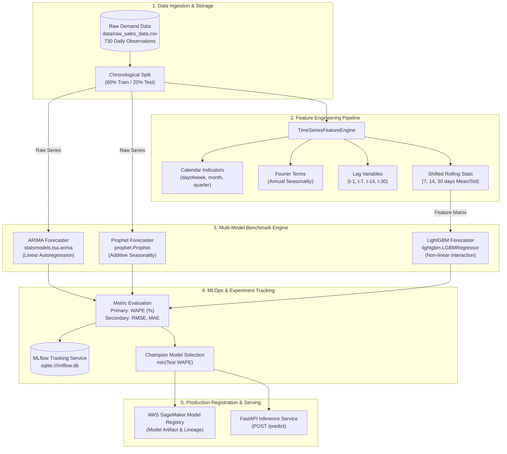

# demand_forcast
# Enterprise Multi-Model Demand Forecasting Engine

[](https://www.python.org/)
[](https://mlflow.org/)
[](https://fastapi.tiangolo.com/)
[](https://aws.amazon.com/sagemaker/)

Production-grade multi-model time-series forecasting and MLOps pipeline. The system trains statistical (**ARIMA**), additive (**Prophet**), and gradient-boosted (**LightGBM**) models in parallel, logs experiments with **MLflow**, benchmarks candidate runs via **WAPE** (Weighted Absolute Percentage Error), and registers champion models on **AWS SageMaker Model Registry**.

---

## 🏛️ System Architecture



---

## 📊 Dataset Specification

### What dataset is used?
The pipeline uses **`data/raw_sales_data.csv`**, a 2-year daily time-series demand dataset spanning **730 days** (2023-01-01 to 2024-12-30).

- **File Path:** [`data/raw_sales_data.csv`](file:///C:/BetaProj/Project/demand_forcast/data/raw_sales_data.csv)
- **Generator Script:** [`data/generate_data.py`](file:///C:/BetaProj/Project/demand_forcast/data/generate_data.py)

### Schema:
| Column | Type | Description | Example |
| :--- | :--- | :--- | :--- |
| `date` | `string` (`YYYY-MM-DD`) | Daily timestamp index | `2023-01-01` |
| `sales` | `float` | Units sold / demand volume | `64.21` |

### Statistical Characteristics:
1. **Macro Trend:** Linear baseline expansion ($\mu = 50 \to 120$ units over the 2-year horizon).
2. **Annual Seasonality:** Multi-cycle sinusoidal seasonality simulating seasonal purchasing patterns ($\pm 25$ amplitude).
3. **Weekly Seasonality:** Day-of-week pattern introducing predictable $+15$ demand spikes on weekends (Saturday/Sunday).
4. **Stochastic Noise:** Gaussian disturbance $\mathcal{N}(0, 6)$ to test model robustness against real-world variance.
5. **Leakage Protection:** Chronological split (first 80% train, last 20% test); all rolling features shifted by 1 ($t-1$) to eliminate lookahead bias.

*Note: The system is modular. You can replace `data/raw_sales_data.csv` with real POS/ERP exports (e.g. Walmart M5, Rossmann, or internal warehouse demand logs) without changing model code.*

---

## 🛠️ Project Structure

```text
├── data/
│   ├── generate_data.py          # Synthetic dataset generator
│   └── raw_sales_data.csv        # Historical daily demand dataset (730 days)
├── src/
│   ├── __init__.py
│   ├── config.py                 # Centralized Pydantic settings & env config
│   ├── api.py                    # FastAPI serving endpoint (/predict, /health)
│   ├── features/
│   │   ├── __init__.py
│   │   └── build_features.py     # Calendar, Fourier, Lag, Rolling stats
│   ├── models/
│   │   ├── __init__.py
│   │   ├── metrics.py            # WAPE, RMSE, MAE metrics calculator
│   │   ├── train_arima.py        # ARIMA forecaster with MLflow logging
│   │   ├── train_prophet.py      # Prophet forecaster with MLflow logging
│   │   └── train_lightgbm.py     # LightGBM forecaster with MLflow logging
│   └── tracking/
│       ├── __init__.py
│       └── mlflow_registry.py    # AWS SageMaker Model Registry integration
├── tests/
│   ├── test_features.py          # Feature engineering unit tests
│   └── test_models.py            # Model training & metrics tests
├── main.py                       # End-to-end benchmark orchestrator
├── pytest.ini                    # Pytest configuration
├── requirements.txt              # Pinned Python package dependencies
├── .env.example                  # Environment configuration template
├── .gitignore                    # Git ignore rules for MLOps
└── README.md
```

---

## 🚀 Getting Started

### 1. Environment Setup
```powershell
uv venv --python 3.12
.venv\Scripts\activate
uv pip install -r requirements.txt
```

### 2. Run the Multi-Model Forecasting Pipeline
```powershell
.venv\Scripts\python.exe main.py
```
This executes:
1. Ingestion of `data/raw_sales_data.csv` (730 rows).
2. Chronological 80/20 train/test split.
3. Feature engineering (calendar, Fourier harmonics, lags $t-1, t-7, t-14, t-30$, rolling windows $7, 14, 30$).
4. Parallel training of **ARIMA**, **Prophet**, and **LightGBM**.
5. Automated experiment logging in MLflow (`sqlite:///mlflow.db`).
6. Model selection leaderboard ranking by **WAPE (%)**.
7. AWS SageMaker Model Registry registration hook for the champion.

### 3. Launch MLflow UI
```powershell
mlflow ui --backend-store-uri sqlite:///mlflow.db --port 5000
```
Open [http://localhost:5000](http://localhost:5000) to inspect runs, parameters, metrics, and logged model artifacts.

### 4. Run Unit Tests
```powershell
.venv\Scripts\pytest.exe -v
```

### 5. Launch FastAPI Serving Endpoint
```powershell
.venv\Scripts\uvicorn.exe src.api:app --reload --port 8000
```
- Health check: `GET http://localhost:8000/health`
- Forecast endpoint: `POST http://localhost:8000/predict`
- Swagger Docs: `http://localhost:8000/docs`